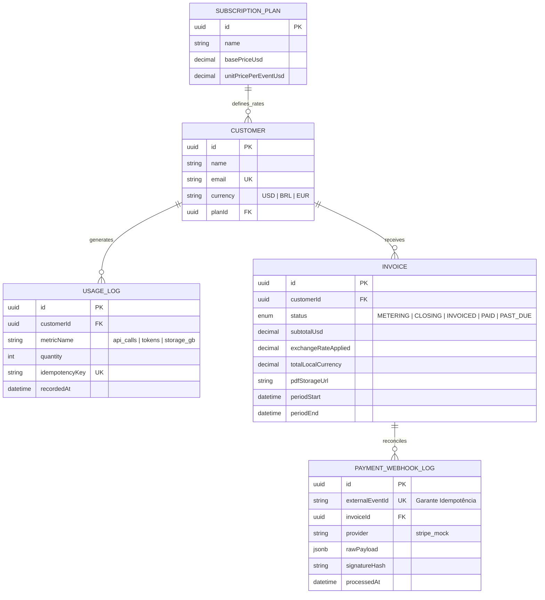

## 1. Conceito Geral do Projeto

Plataforma B2B e sistema interno de **FinOps (Operações Financeiras)** projetado para empresas de SaaS, APIs e Inteligência Artificial que cobram seus clientes com base no consumo real (_Pay-as-you-go_ / _Usage-Based Billing_).

O sistema atua como o núcleo financeiro entre a infraestrutura técnica (que mede eventos como chamadas de API, tokens processados ou gigabytes armazenados) e os gateways de pagamento globais, garantindo que cada evento seja contabilizado com precisão, convertido na moeda correta, transformado em fatura auditável em PDF e reconciliado sem duplicidade.

---

## 2. O Problema que Ele Atende

Startups em escala enfrentam quatro gargalos críticos ao implementar cobrança baseada em uso:

1. **Perda de Receita ou Cobrança Duplicada (Concorrência e Idempotência):** Gateways de pagamento e sistemas de telemetria reenviam eventos quando há instabilidade de rede. Sem chaves de idempotência e transações atômicas, o sistema cobra o cliente duas vezes ou corrompe o saldo.
2. **Lentidão Analítica em Alta Volumetria:** Somar milhões de registros brutos de consumo em tempo real na memória da aplicação trava o banco de dados e degrada a experiência do painel administrativo (frequentemente agravado pelo problema de _N+1 queries_).
3. **Fragilidade em Integrações de Terceiros:** Ao fechar uma fatura internacional, a consulta a APIs externas de câmbio e impostos pode sofrer _timeout_ ou _rate limit_, interrompendo todo o fluxo de faturamento.
4. **Falta de Rastreabilidade e Documentação de Auditoria:** Clientes corporativos exigem faturas detalhadas em PDF com extrato de uso e hash de verificação, além de um histórico claro das mudanças de estado da cobrança.

---

## 3. Soluções Propostas pelo Sistema

- **Ingestão e Reconciliação Idempotente (REST):** Endpoints de alta vazão protegidos por _Rate Limiting_, validação estrita de payload, verificação criptográfica de Webhooks (assinatura HMAC-SHA256) e bloqueio de eventos repetidos via `idempotencyKey`.
- **Consultas Analíticas Otimizadas (GraphQL):** Camada GraphQL _Code-First_ para alimentar o painel operacional em **Next.js**, utilizando agregações nativas no banco de dados, paginação por cursor e resolução otimizada de relacionamentos.
- **Fechamento de Ciclo com Máquina de Estados e Transações ACID:** Automação do fluxo de vida da fatura (`METERING` $\rightarrow$ `CLOSING` $\rightarrow$ `INVOICED` $\rightarrow$ `PAID` / `PAST_DUE`), garantindo que a leitura do consumo, o cálculo cambial e a geração da cobrança ocorram dentro de uma única transação isolada (`prisma.$transaction`).
- **Integração Externa Resiliente:** Serviço de cotação cambial (USD $\leftrightarrow$ BRL/EUR) com estratégia de _Retry_ (_Exponential Backoff_), _Timeout_ configurável e _Fallback_ seguro.
- **Geração Assíncrona de Documentos na Nuvem:** Geração automatizada do PDF executivo da fatura (contendo tabela de consumo, câmbio aplicado e metadados de auditoria) em background, com upload direto para Object Storage compatível com **AWS S3**.
- **Simulador Operacional Integrado (Next.js Dashboard):** Interface administrativa construída com **Tailwind CSS** e **Shadcn/UI** que permite tanto operar as faturas quanto simular picos de uso e disparos de webhooks duplicados em tempo real.

---

## 4. Arquitetura e Entidades de Baixo Nível

### 4.1. Stack Tecnológica (Monorepo)

- **Front-end (`apps/web`):** Next.js (App Router), TypeScript, Tailwind CSS, Shadcn/UI (Radix UI + TanStack Table + Recharts), consumo híbrido GraphQL + REST.
- **Back-end (`apps/api`):** Node.js com NestJS, expondo APIs REST (documentadas via Swagger/OpenAPI) e GraphQL (Apollo Server).
- **Persistência (`Prisma + PostgreSQL`):** Modelagem relacional com tipos decimais exatos (`Decimal(12, 4)`) para evitar erros de ponto flutuante (`IEEE 754`) em cálculos monetários.
- **Infraestrutura & Qualidade:** Docker Compose, AWS S3 SDK, Jest (testes unitários e de concorrência) e GitHub Actions (CI pipeline).

### 4.2. Entidades Principais do Banco de Dados (`schema.prisma`)

### 4.3. Decisões de Baixo Nível e Índices

- **Índice Composto de Consumo:** A tabela `UsageLog` possui um índice composto `@@index([customerId, recordedAt])` no PostgreSQL, permitindo que consultas de agregação (`SUM(quantity)`) para um período específico executem um _Index Scan_ em poucos milissegundos, mesmo com dezenas de milhares de linhas.
- **Locking e Prevenção de Condição de Corrida:** Ao receber dois Webhooks simultâneos com o mesmo `externalEventId`, a constraint `@unique` no banco combinada com o tratamento da exceção `P2002` do Prisma garante que apenas a primeira requisição altere o estado da `Invoice`, enquanto a segunda retorna `200 OK (Already Processed)` sem efeitos colaterais.
- **Sincronização de Estado via URL no Front-end:** Na Data Table do Next.js, filtros de status (`status=PAST_DUE`), busca e cursores de paginação são persistidos nos `searchParams` da URL, permitindo renderização otimizada via Server Components e compartilhamento direto de visões operacionais entre a equipe.
